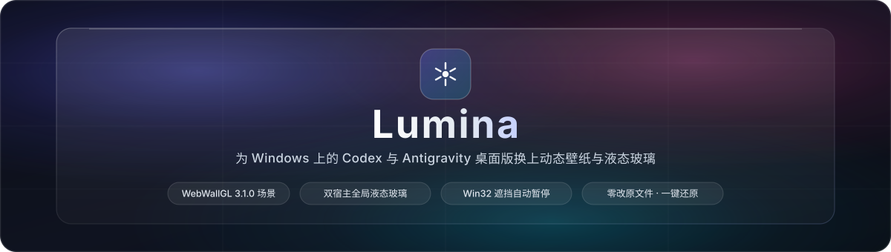
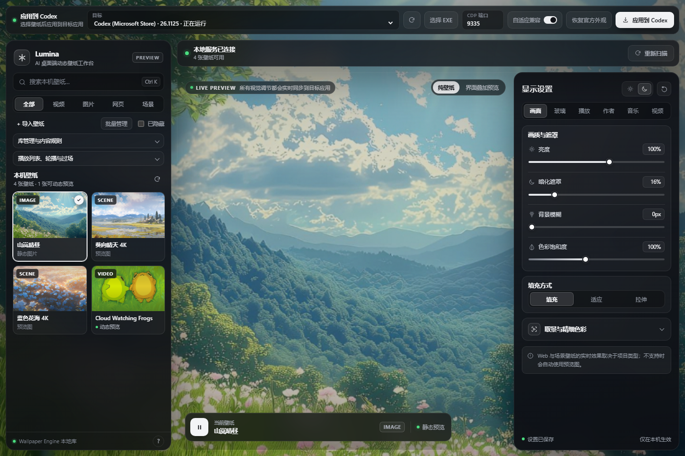
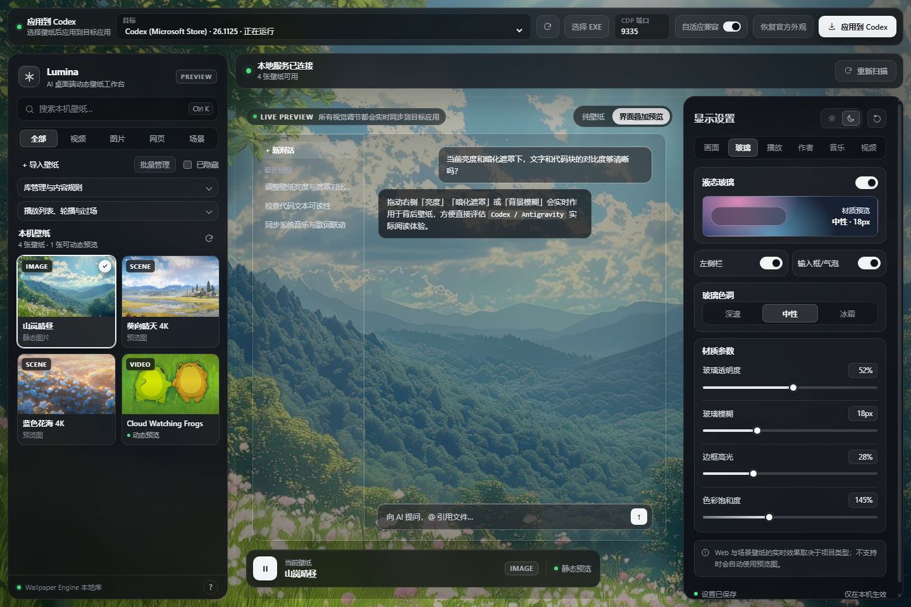

<div align="center">

<picture>
  <source media="(prefers-color-scheme: dark)" srcset="docs/images/hero-dark.svg" />
  <source media="(prefers-color-scheme: light)" srcset="docs/images/hero-light.svg" />
  
</picture>

<br /><br />

[](https://github.com/whisperia6/lumina/releases/latest)


[](LICENSE)

<p>
  <a href="README.md">简体中文</a> &nbsp;|&nbsp; <strong>English</strong>
</p>

<p>
  <a href="#preview">Preview</a> &nbsp;·&nbsp;
  <a href="#highlights">Highlights</a> &nbsp;·&nbsp;
  <a href="#supported-formats">Formats</a> &nbsp;·&nbsp;
  <a href="#quick-start">Quick Start</a> &nbsp;·&nbsp;
  <a href="#build--development">Development</a> &nbsp;·&nbsp;
  <a href="#security--limitations">Security</a>
</p>

<p>
  <sub>Non-destructive dynamic wallpapers and Liquid Glass for <strong>Codex Desktop</strong> &amp; <strong>Antigravity Desktop</strong> on Windows via local Chrome DevTools Protocol (CDP). <strong>Zero installation files modified</strong> — restore the official appearance in one click. Unofficial community project.</sub>
</p>

</div>

---

## Preview

<table>
  <tr>
    <td width="50%" align="center">
      <a href="docs/images/控制台.png"></a>
      <br /><sub><strong>6-Tab Card Workbench</strong> · Target bar, local library &amp; display tuning</sub>
    </td>
    <td width="50%" align="center">
      <a href="docs/images/液态玻璃.png"></a>
      <br /><sub><strong>Global Liquid Glass</strong> · Live material swatch &amp; UI overlay preview</sub>
    </td>
  </tr>
</table>

---

## Highlights

<table>
  <tr>
    <td width="50%" valign="top">
      <strong>WebWallGL 3.1.0 Live Scenes &amp; Smart Fallbacks</strong><br />
      <sub>Ships offline-verified WebWallGL 3.1.0 + Mediabunny. Shows a poster backdrop before the first frame to prevent black flashes, dynamically extends timeouts while chunked packages stream, and automatically falls back to embedded <code>scene.pkg</code> MP4/WebM or static previews on failure.</sub>
    </td>
    <td width="50%" valign="top">
      <strong>Global Liquid Glass for Codex &amp; Antigravity</strong><br />
      <sub>Independent toggles for the master glass effect, sidebar, and composer/message bubbles, plus live controls for opacity, blur, border highlight, saturation, and Dark / Neutral / Frost tints. Updates instantly without restarting and protects menus, dialogs, and text inputs.</sub>
    </td>
  </tr>
  <tr>
    <td width="50%" valign="top">
      <strong>Redesigned 6-Tab Workbench</strong><br />
      <sub>Cleanly organized into <strong>Appearance / Glass / Playback / Author / Music / Video</strong> with segmented pills, 2-column toggle tiles, a live glass material swatch, dark &amp; light themes, and a pure-wallpaper vs. UI-overlay preview switch.</sub>
    </td>
    <td width="50%" valign="top">
      <strong>Win32 Occlusion Auto-Pause &amp; Power Saving</strong><br />
      <sub>Automatically pauses playback when the target window is hidden, <strong>fully occluded by opaque windows above it</strong> (native Win32 Z-order rect-difference check), or on battery power — while preserving manual pause state.</sub>
    </td>
  </tr>
  <tr>
    <td width="50%" valign="top">
      <strong>Fast Dual-Host Injection &amp; Native Helper</strong><br />
      <sub>Auto-discovers Store/EXE Codex and Antigravity Desktop; launches Store builds via native COM AUMID to prevent duplicate taskbar icons. Precompiled <code>cwb-win-helper.exe</code> cuts port/process verification to ~130 ms and preserves proxy flags with automatic <code>127.0.0.1</code> bypass.</sub>
    </td>
    <td width="50%" valign="top">
      <strong>Playlists, Music Sync &amp; Update Notifications</strong><br />
      <sub>Multi-playlists, WE JSON import, 7 transitions, 20 GiB deduplicated local imports, optional system audio spectrum / Now Playing / LRC lyrics / media controls, MP4 Faststart &amp; ffmpeg transcoding, plus silent GitHub Releases update checks.</sub>
    </td>
  </tr>
</table>

---

## Supported Formats

| Type | Capabilities |
| --- | --- |
| **Scene** | Real-time GPU rendering via bundled WebWallGL 3.1.0, WE author properties, audio reactivity, first-frame poster backdrop, embedded MP4/WebM fallback, and manual retry |
| **Web** | Local web wallpaper projects with WE author properties, system audio spectrum, media info, single-loop hold, and extended control callbacks |
| **Video** | Local MP4 imports or WE video wallpapers streamed on demand via local HTTP Range; playback rate, volume, virtual MP4 Faststart, and optional ffmpeg transcoding |
| **Image** | Local JPG/PNG imports or WE image projects with live framing, zoom, mirror, and color adjustments |

---

## Quick Start

### Requirements
- **Windows 10 / 11 (x64)** with Codex Desktop (Microsoft Store or EXE) or Antigravity Desktop installed.
- Wallpaper Engine is **optional** if you only import your own images or videos; `ffmpeg` / `ffprobe` is only needed for optional video transcoding.

### Option 1: Windows Installer (Recommended)

Download the latest NSIS installer from [GitHub Releases](https://github.com/whisperia6/lumina/releases/latest) (current: `v1.4.0` — [Lumina-1.4.0-Setup.exe](https://github.com/whisperia6/lumina/releases/download/v1.4.0/Lumina-1.4.0-Setup.exe)):
- Supports custom install directory, instant startup, and preserves user settings on uninstall.

### Option 2: Run from Source (Node.js 22+)

```powershell
git clone https://github.com/whisperia6/lumina.git
cd lumina
npm ci
npm start
```

You can also double-click `run-electron.cmd` after installing dependencies.

### First-Time Setup
1. Select **Codex** or **Antigravity** in the top target bar (or click **Select EXE** manually).
2. Scan your local Wallpaper Engine library or import your own images/videos, then tune **Appearance** and **Glass** settings on the right.
3. Click **Apply**: if a verified debug port is ready, Lumina injects immediately; otherwise confirm restarting the target in debug mode (save unsent drafts first).
4. Click **Restore Official Appearance** or exit from the system tray at any time to cleanly remove all injected backgrounds and styles.

---

## Build & Development

<details>
<summary><strong>Expand: Packaging, environment variables, project layout &amp; tests</strong></summary>

<br />

### Build Installer

```powershell
npm ci
npm run package
```

Or double-click `make-electron.cmd`. Output is written to `out/release-<version>/Lumina-<version>-Setup.exe`.

### Optional Environment Variables

| Variable | Description |
| --- | --- |
| `CWB_FFMPEG_PATH` / `CWB_FFPROBE_PATH` | Explicit paths to `ffmpeg.exe` / `ffprobe.exe` when not on `PATH` |
| `CWB_CACHE_ROOT` | Override the video transcode cache directory |
| `CWB_BUILD_TEMP_ROOT` | Override the temporary packaging directory (default: `out/.nsis-build`) |

### Development & Tests

When editing bridge logic, if a matching file exists under `bridge-overrides/`, edit `bridge-overrides/` and run `npm run sync:bridge`. Never hand-edit `dist/`.

```powershell
npm run sync:bridge
npm run build:app
npm test
```

</details>

---

## Security & Limitations

<details>
<summary><strong>Expand: Local privacy, CSP notes &amp; known limitations</strong></summary>

<br />

- **Local-only data**: All wallpaper settings stay on your machine. Local media and control servers bind exclusively to `127.0.0.1` with random session tokens and origin validation.
- **CSP note**: Image, video, and GPU Scene injection temporarily relaxes CSP on the target page (the first injection may reload once) and restores it when reverting to the official appearance. Only load trusted local Web wallpapers.
- **Known limitations**:
  - Windows x64 only (no macOS / Linux, web ChatGPT, or CLI Codex).
  - Scene/Web rendering is not a 100% drop-in replacement for the official Wallpaper Engine client.
  - Future host app updates may alter DOM structure; please open an issue if any overlay misalignment occurs.
  - Releases are currently unsigned, so Windows SmartScreen may show an "Unknown publisher" prompt.

</details>

---

## License & Credits

- Released under the [MIT License](LICENSE).
- Scene rendering is powered by **WebWallGL 3.1.0**; see [third-party notices](bridge-runtime/vendor/webwallgl/NOTICE.md) for upstream credits and licenses.
- Additional docs: [Runtime Guide](bridge-runtime/README.md) · [Web API](docs/WEB_API.md) · [v1.4.0 Release Notes](docs/RELEASE_1.4.0.md).
