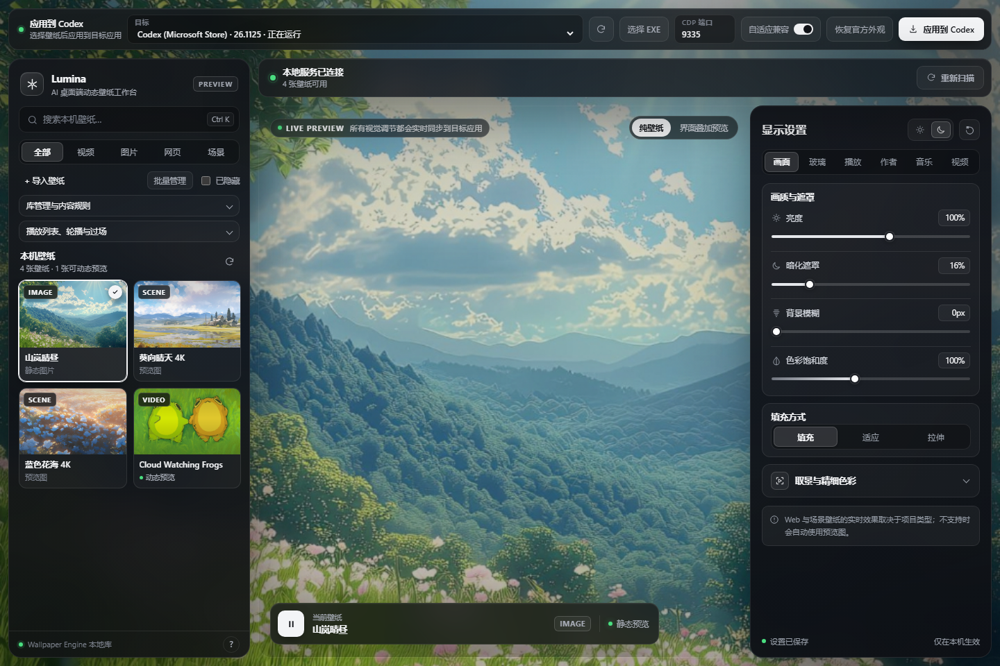
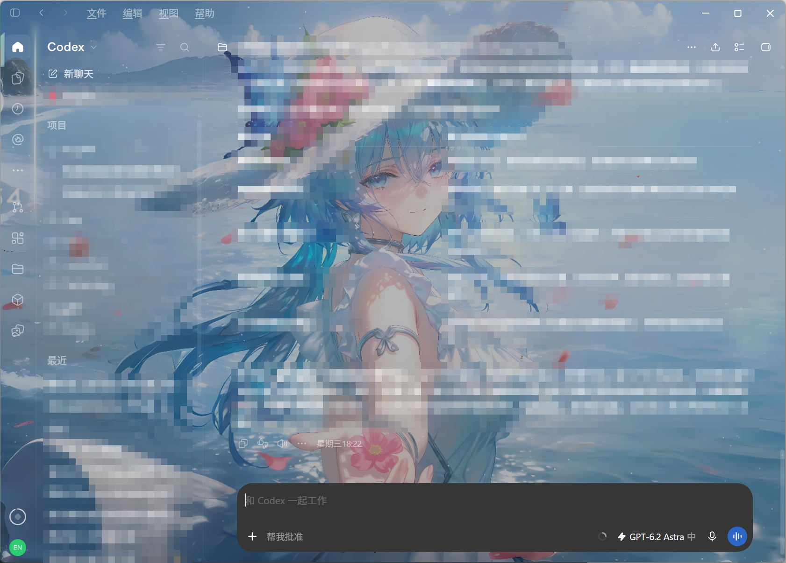

# Codex Wallpaper Desktop

一个面向 Windows 的 **Codex 桌面版动态壁纸工作台**。支持导入本地图片、视频，或直接读取本机已有的 Wallpaper Engine 壁纸库（图片 / 视频 / Web / Scene 场景），在同一界面完成预览、调参、轮播与一键注入。

程序仅通过本机 Chrome DevTools Protocol（CDP）在运行时挂载背景层，**不修改 Codex 安装文件**，随时可一键恢复官方原貌。本项目为非官方工具，与 OpenAI 及 Wallpaper Engine 官方无关。

## 界面预览





> 截图展示整体布局，最新新增选项以实际工作台为准。

---

## 核心特性

### 1. 多类型壁纸与 GPU 实时预览

| 类型 | 支持能力 |
| --- | --- |
| **图片** | 导入 JPG / PNG，或读取本地壁纸项目；实时取景与画面调校 |
| **视频** | 导入 MP4 或读取本地视频壁纸；本机 HTTP Range 流式按需读取，支持倍速、暂停与音量控制 |
| **Web 壁纸** | 加载本地网页项目，支持作者属性、系统频谱、媒体信息及扩展控制回调 |
| **Scene 场景** | 基于 WebWallGL 的 GPU 实时渲染，支持作者属性、频谱响应及失败自动回退与手动重试 |

### 2. 画面调节、过场与播放列表
- **画面调校**：适配模式（填充 / 适应 / 拉伸）、焦距位置、缩放、水平镜像；亮度、暗化、背景模糊（含防边缘黑边过扫描）、饱和度、对比度与不透明度——图片、视频、Web 与 Scene 场景均生效。
- **轮播与过场**：多播放列表、顺序 / 随机轮播、导入 Wallpaper Engine 播放列表 JSON；支持硬切、淡化、推移、擦除、光圈、缩放、条带 7 种过场动画，以及“减少动态效果”。
- **智能暂停**：窗口隐藏或电池供电时自动暂停，与手动暂停状态互不覆盖。
- **壁纸库管理**：按类型、关键词、分级（Everyone / PG13 / Mature / 未分级）筛选；支持批量隐藏与恢复、导入去重（单文件上限 20 GiB）、资源库无损迁移；Wallpaper Engine 原件始终只读。

### 3. WE 作者属性与系统音乐联动
- **WE 作者属性**：自动解析 Scene / Web 壁纸的颜色、开关、滑块、下拉、文本、文件与目录配置，按壁纸独立保存并支持一键重置。
- **系统音乐联动（默认全部关闭）**：按需开启系统输出频谱（不经过麦克风）、正在播放信息（曲名 / 歌手 / 封面 / 进度）、本地 LRC 歌词与可选 LRCLIB 在线歌词、以及播放器反向控制。

### 4. 视频优化与缓存管理
- 支持 MP4 Faststart 虚拟前置，不改写原始视频文件。
- 可选接入本机 `ffmpeg` / `ffprobe`，提供帧率上限、编码器选择、后台转码与取消/重试；转码期间继续播放原片。
- 独立缓存目录管理，支持带校验的跨盘迁移。

### 5. 双版本 Codex 兼容与极速注入
- **版本支持**：自动发现 Microsoft Store 版与本地 EXE 版 Codex，并支持手动指定便携版 `ChatGPT.exe`。
- **Store 单图标启动**：Microsoft Store 版通过 Windows COM `IApplicationActivationManager` 以原生 AUMID 身份启动，避免任务栏双图标。
- **原生辅助程序加速**：内置构建期预编译的 `cwb-win-helper.exe`（调用 `iphlpapi` / `NtQueryInformationProcess` / `QueryFullProcessImageName`），端口身份核验与进程发现从数秒级降至 ~130 ms，热重注 1 秒左右完成，且保留全部端口与进程归属安全校验。
- **新版界面适配**：使用语义 `:has()` 规则清除新版 Codex 顶栏、侧栏及底部输入框页脚伪元素深色遮罩，不影响输入框本体与弹窗。
- **托盘常驻与安全接管**：关闭或最小化至系统托盘维持媒体服务；重新打开普通模式 Codex 时先弹窗确认再接管，随时支持“恢复官方外观”。

---

## 安装与使用

### 环境要求
- Windows 10 / 11（x64），已安装 Codex 桌面版（Microsoft Store 版或本地 EXE 版）。
- 仅使用自有图片 / 视频时**不需要**安装 Wallpaper Engine。
- 仅在使用视频转码优化时需要本机安装 `ffmpeg` 和 `ffprobe`。

### 方式一：使用 NSIS 安装包（推荐）
从 [GitHub Releases](https://github.com/whisperia6/codex-wallpaper-bridge/releases) 下载最新版安装包（当前 `v1.2.0`：[CodexWallpaperDesktop-1.2.0-Setup.exe](https://github.com/whisperia6/codex-wallpaper-bridge/releases/download/v1.2.0/CodexWallpaperDesktop-1.2.0-Setup.exe)）：
- 中文安装向导，支持自选安装路径（推荐安装到 D / F 盘）。
- 安装后启动即秒开，无需每次向 C 盘 `Temp` 解压临时文件。
- 卸载时默认保留个人壁纸设置。

### 方式二：从源码运行（需 Node.js 22+）

```powershell
git clone https://github.com/whisperia6/codex-wallpaper-bridge.git
cd codex-wallpaper-bridge
npm ci
npm start
```

安装依赖后也可以直接双击根目录的 `run-electron.cmd`。

### 首次应用壁纸步骤
1. 在工作台顶部选择目标 Codex 版本（未自动发现本地版时点击“选择本地 EXE”）。
2. 扫描本机 Wallpaper Engine 目录，或直接导入自己的图片 / 视频，调整预览效果。
3. 点击 **“应用到 Codex”**：若匹配端口已就绪将直接注入；若 Codex 正以普通模式运行，按提示确认重启进入调试模式（请先保存未发送输入）。
4. 首次以独立调试 profile 启动 Codex 可能需要重新登录。不再使用时点击 **“恢复官方外观”** 或从托盘退出即可。

### 可选环境变量

| 变量名 | 说明 |
| --- | --- |
| `CWB_FFMPEG_PATH` / `CWB_FFPROBE_PATH` | 手动指定 `ffmpeg.exe` / `ffprobe.exe` 路径（未加入 `PATH` 时使用） |
| `CWB_CACHE_ROOT` | 覆盖视频转码缓存目录 |
| `CWB_BUILD_TEMP_ROOT` | 覆盖打包时的临时构建目录（Windows 下存在 `F:\` 时默认使用 `F:\.cwb-build-tmp`） |

---

## 构建与打包

```powershell
npm ci
npm run package
```

或安装依赖后双击 `make-electron.cmd`（等价于 `npm run make`）。

打包产物输出至：

```text
out/release-<版本号>/CodexWallpaperDesktop-<版本号>-Setup.exe
```

打包流程说明：
- 构建阶段会同步 `bridge-overrides/`、用 `esbuild` 压缩主程序与桥接运行时，并用系统 `.NET Framework` `csc.exe` 预编译 `windows-media.dll` 与 `cwb-win-helper.exe`。
- 使用 `electron-builder` 生成 NSIS x64 安装包，仅保留 `zh-CN` / `en-US` 语言包，并启用 ASAR 封装、嵌入式 ASAR 完整性校验及 Electron Fuses。
- 临时构建目录在 Windows 下优先使用 `F:\.cwb-build-tmp`（可通过 `CWB_BUILD_TEMP_ROOT` 覆盖，无 F 盘时自动回退到 `out/.nsis-build`），构建完成后自动清理。

---

## 项目目录结构

```text
codex-wallpaper-bridge/
├── src/                      # Electron 主进程、IPC、目标发现、CDP 身份核验与渲染外壳
│   ├── main.mjs              # Electron 入口、托盘与生命周期管理
│   ├── cdp-owner.mjs         # CDP 监听端口与进程归属核验
│   ├── codex-launcher.mjs    # Store AUMID 激活、进程关闭与调试模式启动
│   ├── compatibility-script.mjs # Codex 界面透明与页脚遮罩兼容脚本
│   ├── installations.mjs     # Codex 安装发现与缓存
│   ├── win-helper.mjs        # 原生 Windows 辅助程序调用与安全回退
│   └── renderer/             # 桌面外壳前端资源
├── bridge-runtime/           # 内置壁纸服务、工作台 UI、媒体传输与原生组件源码
│   ├── native/               # windows-media.cs / cwb-win-helper.cs
│   ├── public/               # 壁纸工作台前端界面
│   ├── src/                  # 本地媒体服务、场景服务、播放策略
│   └── vendor/webwallgl/     # WebWallGL 场景渲染组件与开源许可声明
├── bridge-overrides/         # Electron 桌面版对 bridge-runtime 的覆盖维护源
├── scripts/                  # 同步、构建、原生编译、NSIS 打包与验收脚本
├── test/                     # Node 自动化单元测试与浏览器渲染测试
├── docs/                     # 公开文档（WEB_API、版本说明）与界面截图
├── run-electron.cmd          # Windows 一键源码启动脚本
└── make-electron.cmd         # Windows 一键打包脚本
```

### 开发约定与测试
- 修改桥接逻辑时，若 `bridge-overrides/` 中存在同名文件，请修改 `bridge-overrides/` 并运行 `npm run sync:bridge`；请勿直接手改 `dist/`。
- 运行测试：

```powershell
npm run sync:bridge
npm run build:app
npm test
```

或按模块定向运行，例如：

```powershell
node --test test/win-helper.test.mjs test/cdp-owner.test.mjs test/compatibility-surfaces.test.mjs
```

---

## 数据、安全与已知限制

- **本地数据与隐私**：所有壁纸配置均存放在本机；运行日志默认位于 `%LOCALAPPDATA%\CodexWallpaperDesktop\logs`（会话 URL 已脱敏）。本地媒体与控制服务仅监听 `127.0.0.1` 并校验随机令牌与请求来源。
- **CSP 说明**：图片、视频及 GPU 场景注入会在目标页面临时放宽 CSP（首次可能需要自动刷新一次页面），恢复外观时会还原。网页壁纸包含作者脚本，请仅加载可信的本地项目。
- **已知限制**：
  - 仅支持 Windows x64；不支持 macOS / Linux，也不适用于网页版 ChatGPT 或命令行 Codex。
  - Scene / Web 渲染并非 Wallpaper Engine 官方完整替代，部分高级脚本与插件特效可能不兼容。
  - Codex 版本升级可能调整 DOM 结构，如出现界面遮挡或样式异常欢迎反馈。
  - 当前未配置商业代码签名证书，安装或运行时 Windows SmartScreen 可能出现“未知发布者”提示。

---

## 更多文档与致谢

- [运行时说明](bridge-runtime/README.md) · [Web 壁纸扩展接口](docs/WEB_API.md) · [1.2.0 版本说明](docs/RELEASE_1.2.0.md) · [1.1.0 版本说明](docs/RELEASE_1.1.0.md) · [1.0.0 版本说明](docs/RELEASE_1.0.0.md)
- 场景渲染基于 WebWallGL，相关组件来源、版本与开源许可见 [第三方声明](bridge-runtime/vendor/webwallgl/NOTICE.md)。
